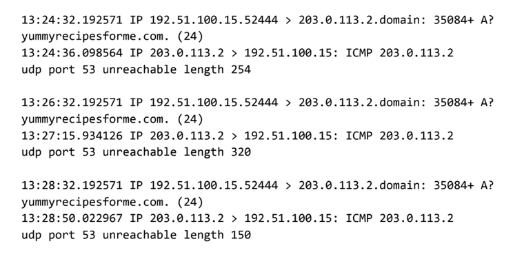

## Informe de incidente de ciberseguridad: Análisis de tráfico de red

> 📄 **[Ver informe formal en formato PDF](./Informe_de_Analisis_de_Trafico_de_Red.pdf)**

---
## 📝 Contexto del Escenario

Como analista de ciberseguridad en una empresa de servicios informáticos, se reportó un incidente donde múltiples clientes no podían acceder al sitio web de la empresa cliente (`www.yummyrecipesforme.com`). Tras un tiempo prolongado de carga, los navegadores arrojaban el error *"puerto de destino inalcanzable"*. 

El objetivo de este proyecto fue investigar la interrupción del servicio utilizando la herramienta de análisis de protocolos de red **tcpdump** para capturar el tráfico en tránsito, identificar el protocolo de red afectado y determinar la causa raíz del incidente.

---
---

## Evidencia: Registro de Tráfico (tcpdump)

*(A continuación se muestra la captura del tráfico de red analizado)*

---

## Parte 1: Proporcione un resumen del problema encontrado en el registro de tráfico DNS e ICMP.

* **El protocolo UDP revela que:** El equipo del cliente envía correctamente los paquetes con las solicitudes de resolución de nombres de dominio hacia el servidor, pero no logra establecer una comunicación exitosa con el servicio en el destino.
* **Esto se basa en los resultados del análisis de red, que muestran que la respuesta de eco ICMP devolvió el mensaje de error:** "Puerto udp 53 inalcanzable" (udp port 53 unreachable).
* **El puerto indicado en el mensaje de error se utiliza para:** El servicio de Sistema de Nombres de Dominio (DNS).
* **El problema más probable es:** El servicio DNS en el servidor de destino (203.0.113.2) está inactivo, no configurado o bloqueado por un firewall, lo que le impide escuchar peticiones en el puerto 53 y devolver la dirección IP del sitio web solicitado.

---

## Parte 2: Explique su análisis de los datos y proporcione al menos una causa del incidente.

* **Hora en que ocurrió el incidente:** A las 13:24 (según la marca de tiempo inicial del registro: 13:24:32.192571).
* **Explique cómo el equipo de TI se enteró del incidente:** Varios clientes informaron que no podían acceder al sitio web de la empresa cliente (www.yummyrecipesforme.com) y que veían el error "puerto de destino inalcanzable" después de un largo tiempo de espera de carga.
* **Explique las acciones tomadas por el departamento de TI para investigar el incidente:** Un analista intentó visitar la página y recibió el mismo error. Para investigar la causa, el analista ejecutó la herramienta de análisis de protocolos de red tcpdump y volvió a intentar cargar la página para capturar el tráfico de la red e identificar en qué punto se interrumpía la conexión.
* **Anote los hallazgos clave de la investigación del departamento de TI (es decir, detalles relacionados con el puerto afectado, el servidor DNS, etc.):** El registro de tcpdump indicó que el problema ocurre en la etapa de resolución DNS. El equipo de origen envió múltiples consultas UDP solicitando un registro "A" al servidor DNS en la dirección 203.0.113.2 a través del puerto 53. Por cada solicitud, el servidor devolvió un paquete de error ICMP indicando que el puerto estaba "inalcanzable".
