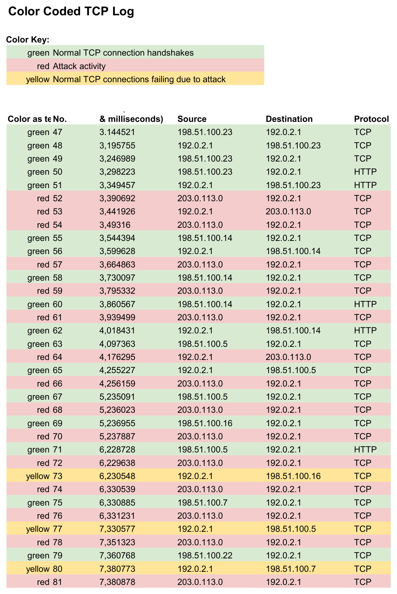
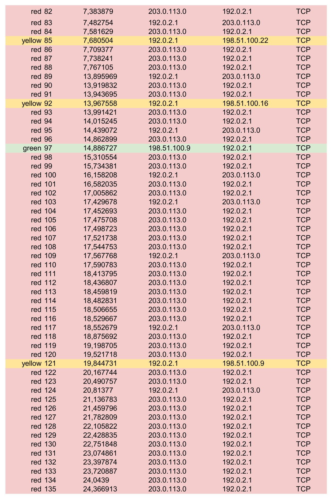

## Informe de incidente de ciberseguridad: Ataque de inundación SYN (DoS)

**[Ver informe formal en formato PDF](./Informe-incidente-ciberseguridad.pdf)**

---

## Contexto del Escenario

Como analista de seguridad en una agencia de viajes, recibí una alerta automática del sistema de monitoreo indicando un problema con el servidor web. Al intentar acceder al sitio de ventas de la empresa, el navegador devolvía un error de **tiempo de espera de conexión agotado**.

Mediante un analizador de paquetes (Wireshark) capturé el tráfico hacia y desde el servidor web, observando un volumen anormalmente alto de peticiones TCP SYN provenientes de una única dirección IP desconocida.

El objetivo de este proyecto fue identificar el tipo de ataque, explicar cómo afectaba al servidor y proponer medidas de mitigación.

---

## Evidencia: Registro de Tráfico (Wireshark)

*(A continuación se muestra la captura del tráfico de red analizado)*

El registro TCP con código de colores muestra el patrón del ataque:
verde = conexiones legítimas · rojo = actividad del ataque (203.0.113.0) · amarillo = conexiones legítimas fallando por el ataque.

- **192.0.2.1** → servidor web de la empresa
- **198.51.100.0/24** → equipos de los empleados (tráfico legítimo)
- **203.0.113.0** → IP atacante (inundación SYN)

---

## Sección 1: Identificar el tipo de ataque

Una posible explicación para el error de tiempo de espera de conexión es un ataque de **denegación de servicio (DoS)** del tipo **inundación SYN (SYN flood)**.

Los registros muestran que una única dirección IP desconocida (203.0.113.0) envía un volumen anormalmente alto de paquetes TCP SYN al servidor (192.0.2.1) en el puerto 443, sin completar el protocolo de enlace de tres vías. A medida que avanza el ataque, el servidor comienza a rechazar o reiniciar (RST) conexiones de usuarios legítimos.

Como el tráfico malicioso proviene de **una sola IP**, corresponde a un ataque **DoS** y no a un **DDoS** (que usaría múltiples fuentes distribuidas).

---

## Sección 2: Explicar cómo el ataque provoca el mal funcionamiento del sitio web

**Los tres pasos del protocolo de enlace TCP (three-way handshake):**

1. **SYN:** el cliente envía un paquete SYN al servidor para solicitar una conexión.
2. **SYN-ACK:** el servidor responde con SYN-ACK, reservando recursos y confirmando la solicitud.
3. **ACK:** el cliente responde con ACK y la conexión queda establecida; recién entonces se transmiten datos.

**Qué ocurre cuando un actor malicioso envía muchos SYN a la vez:**
El servidor responde con SYN-ACK a cada petición y reserva recursos esperando el ACK final. Como el atacante nunca completa el handshake, esas conexiones quedan "medio abiertas" ocupando la tabla de conexiones. Al recibir miles de SYN falsos, el servidor agota su memoria y capacidad, y deja de aceptar conexiones nuevas.

**Qué indican los registros y cómo afecta al servidor:**
La IP 203.0.113.0 envía SYN de forma repetida y sostenida. El servidor se satura y las conexiones de empleados legítimos (198.51.100.x) comienzan a fallar o son reiniciadas (RST), lo que explica el error de tiempo de espera. El sitio de ventas queda inaccesible.

---

## Impacto y mitigación

**Consecuencias:** indisponibilidad del sitio web, empleados sin acceso a la página de ventas, pérdida de oportunidades comerciales y daño a la reputación de la empresa.

**Medidas de mitigación recomendadas:**
- Limitación de tasa (rate limiting) en el firewall.
- Cookies SYN (SYN cookies) para no reservar recursos hasta completar el handshake.
- Sistemas de detección/prevención de intrusiones (IDS/IPS).
- Servicios de protección anti-DDoS.

---

*Ejercicio 2 — Curso 3 (Seguridad de redes) del Certificado Profesional de Ciberseguridad de Google. Trabajo propio basado en un escenario ficticio del curso.*
