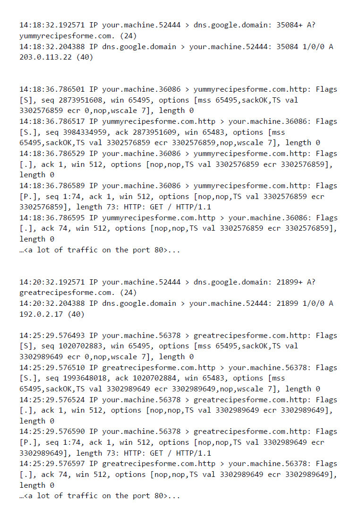

# Informe de incidente de seguridad: Ataque de fuerza bruta y redireccionamiento malicioso

[Ver informe de incidente completo (PDF)](Informe-incidente-seguridad.pdf)
## Contexto del escenario

Trabajo como analista de ciberseguridad para **yummyrecipesforme.com**, un sitio que vende recetas y libros de cocina. Un antiguo empleado ejecutó un **ataque de fuerza bruta** contra la cuenta administrativa del host web: probó repetidamente contraseñas por defecto conocidas hasta acertar, porque la cuenta de administrador mantenía la contraseña por defecto y no existían controles para limitar los intentos de inicio de sesión.

Con acceso al panel de administración, el atacante modificó el código fuente e insertó una función **JavaScript** que pedía a los visitantes descargar y ejecutar un archivo, y luego cambió la contraseña de administrador. Los clientes que ejecutaban el archivo eran redirigidos a un sitio falso, **greatrecipesforme.com**, con malware, y sus equipos se ralentizaban.

Para investigar, se creó un entorno **sandbox** y se ejecutó el analizador de protocolos **tcpdump** accediendo al sitio, confirmando el redireccionamiento malicioso.

## Evidencia: registro de tráfico (tcpdump)

Flujo observado en el registro:
- Consulta **DNS** de `yummyrecipesforme.com` → resuelve a `203.0.113.22`
- Conexión **TCP** (handshake: Flags `[S]`, `[S.]`, `[.]`) y petición **HTTP** `GET / HTTP/1.1` (puerto 80)
- Cambio repentino: nueva consulta **DNS** de `greatrecipesforme.com` → resuelve a `192.0.2.172`
- Tráfico **HTTP** redirigido al sitio suplantado

## Preguntas de la actividad

**Paso 3 — Identificar el protocolo de red**
- ¿Qué protocolo(s) de red se identifican en las capturas de paquetes durante la investigación?
- ¿En qué capa del Modelo TCP/IP ocurre cada uno?

**Paso 4 — Documentar el incidente**
- ¿Dónde ocurrió el incidente?
- ¿Cómo sucedió?
- ¿Alguien lo presenció / cómo se descubrió?
- ¿Cuáles son las fuentes de información y pruebas?

**Paso 5 — Recomendar una solución para ataques de fuerza bruta**
- ¿Qué medida de seguridad recomienda y por qué es eficaz?

---

## Sección 1: Protocolo de red identificado

Protocolos identificados: **DNS**, **HTTP** y **TCP** (sobre **IP**), según las capas del Modelo TCP/IP:

- **DNS** (capa de aplicación): el navegador solicita al servidor DNS (`dns.google`) la IP de `yummyrecipesforme.com` (`203.0.113.22`); luego se repite una consulta para `greatrecipesforme.com` (`192.0.2.172`).
- **HTTP** (capa de aplicación): petición `HTTP: GET / HTTP/1.1` sobre el puerto 80 (sufijo `.http`).
- **TCP** (capa de transporte): protocolo de enlace de tres vías visible en los indicadores `[S]` (inicio), `[S.]` y `[.]` (confirmación).
- **IP** (capa de Internet): direccionamiento entre el equipo de origen y los destinos.

El protocolo principal implicado en el redireccionamiento malicioso es **HTTP**, apoyado por **DNS** para la resolución de nombres, todo transportado sobre **TCP/IP**.

## Sección 2: Documentación del incidente

**Dónde:** sitio web `yummyrecipesforme.com` (host web de la empresa).

**Cómo sucedió:** un antiguo empleado ejecutó un ataque de fuerza bruta contra la cuenta administrativa, que mantenía la contraseña por defecto y no tenía límite de intentos de inicio de sesión. Tras acceder, modificó el código fuente insertando JavaScript que inducía a descargar y ejecutar un archivo, cambió la contraseña de administrador y redirigió a las víctimas a `greatrecipesforme.com` (malware).

**Cómo se descubrió:** varias horas después, varios clientes escribieron al servicio de asistencia reportando que el sitio les pedía descargar un archivo y que, tras ejecutarlo, la dirección cambiaba y sus equipos se ralentizaban. El propietario no pudo acceder al panel de administración y contactó al proveedor de alojamiento.

**Investigación:** el equipo creó un sandbox y ejecutó tcpdump; el registro mostró la consulta DNS inicial, la descarga vía HTTP y el redireccionamiento al sitio suplantado. Un analista senior confirmó el compromiso y halló el JavaScript inyectado.

**Fuentes y pruebas:** registro de tráfico tcpdump; correos de clientes al servicio de asistencia; revisión del código fuente; confirmación del analista senior; informe del equipo de ciberseguridad.

## Sección 3: Recomendación contra fuerza bruta

**Medida recomendada: autenticación de dos factores (2FA).**

Un ataque de fuerza bruta depende de adivinar la contraseña probando muchas combinaciones. Con 2FA, la contraseña por sí sola no basta para iniciar sesión: se exige un segundo factor (código temporal de una app de autenticación o token físico) que el atacante no posee. Así, aunque la contraseña sea débil, por defecto o quede expuesta, el acceso a la cuenta administrativa queda bloqueado.

**Medida complementaria clave para este caso: impedir el uso de contraseñas anteriores o por defecto.** Como la causa raíz fue que la cuenta administrativa conservaba la contraseña por defecto, bloquear la reutilización de contraseñas antiguas o por defecto al restablecerlas ataca directamente esa vulnerabilidad. Conviene además exigir contraseñas largas (15 caracteres o más) y limitar los intentos de inicio de sesión.

*Ejercicio 3 — Curso 3 (Seguridad de redes) del Certificado Profesional de Ciberseguridad de Google. Trabajo propio basado en un escenario ficticio del curso.*
